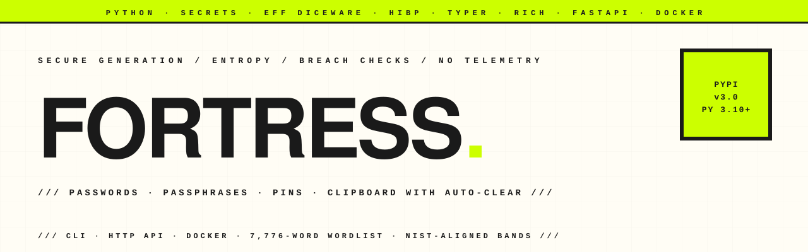

<p align="center">
  <picture>
    <source media="(prefers-color-scheme: dark)" srcset="assets/hero-banner-dark.svg" />
    
  </picture>
</p>

<p align="center">
  <a href="https://github.com/hatimhtm/Fortress/actions/workflows/ci.yml"></a>
  <a href="https://pypi.org/project/fortress/"></a>
  <a href="https://github.com/hatimhtm/Fortress/pkgs/container/fortress"></a>
  
  <a href="LICENSE"></a>
</p>

<p align="center">
  <em>A cryptographically secure password / passphrase / PIN generator with real entropy math, multi-scenario crack-time estimates, and breach-corpus lookups via HaveIBeenPwned. CLI, FastAPI HTTP server, Docker image. Stdlib core (zero runtime deps for the library itself). Python 3.10+.</em>
</p>

## What it does

```
                 ┌─────────────────────────────────────────────────┐
                 │           secrets.choice (os.urandom)           │
                 └────────────────────┬────────────────────────────┘
                                      │
        ┌─────────────────────────────┼─────────────────────────────┐
        ▼                             ▼                             ▼
┌───────────────┐         ┌──────────────────────┐         ┌────────────────┐
│ Password      │         │ Passphrase           │         │ PIN            │
│ ──────────    │         │ ──────────           │         │ ──────────     │
│ 94-char       │         │ EFF Diceware Large   │         │ 0–9            │
│ ASCII charset │         │ 7,776 words          │         │ 1–32 digits    │
│ ≥ 130 bits    │         │ ≈ 12.93 bits / word  │         │ 3–106 bits     │
└───────┬───────┘         └──────────┬───────────┘         └───────┬────────┘
        │                            │                             │
        └──────────────┬─────────────┴─────────────────────────────┘
                       ▼
            ┌──────────────────────┐         ┌──────────────────────┐
            │ Entropy + crack-time │ ◀────── │ HIBP k-anonymity     │
            │ (5 attack scenarios) │ check   │ + 1,000-word         │
            └──────────────────────┘         │ NCSC common-list     │
                                             └──────────────────────┘
```

Three primitives (`generate_password`, `generate_passphrase`, `generate_pin`) all sourced from Python's `secrets` (CSPRNG, ultimately `os.urandom`). Every output is annotated with **actual** entropy (when Fortress generated it, the math is exact) and rendered against five attacker scenarios from "online throttled" to "ASIC cluster offline." The `check` command analyses arbitrary passwords against the embedded NCSC top-1,000 blocklist and optionally against the live HaveIBeenPwned breach corpus via k-anonymity (only 5 hex chars of the SHA-1 leave your machine).

## Quick start

```bash
pip install fortress                  # CLI only - 2 deps (typer, rich)
pip install 'fortress[server]'        # adds FastAPI HTTP API
```

```bash
# Generate a strong password, copy to clipboard, clear after 30s
fortress generate --length 24 --copy 30

# An EFF Diceware passphrase - 6 words ≈ 77 bits
fortress passphrase --words 6 --capitalize

# A 6-digit PIN
fortress pin --length 6

# Check a password - local blocklist only
fortress check "hunter2"

# …or also against HIBP's breach corpus
fortress check "hunter2" --pwned

# Pipe-friendly machine output
fortress generate --length 32 --json | jq -r .password

# Run as an HTTP API
fortress serve --port 8000
```

Docker:

```bash
docker run --rm ghcr.io/hatimhtm/fortress:latest generate --length 24
docker run --rm -p 8000:8000 ghcr.io/hatimhtm/fortress:latest serve
```

## Highlights

| | |
|---|---|
| **CSPRNG only** | Every random byte comes from `secrets`/`os.urandom`. No `random` anywhere. |
| **EFF Diceware Large wordlist** | 7,776 words at ≈ 12.93 bits/word: replaces the 60-word stub from 2.x. Six-word default gives ≈ 77 bits. |
| **Real entropy math** | When Fortress generates a password it knows the charset, so `entropy = length · log₂(charset)` is exact. For user-supplied passwords (`check`), the heuristic upper bound is clearly labelled. |
| **Five crack-time scenarios** | Throttled online (100 g/s) → ASIC offline (10¹² g/s). One number is misleading; we show the spread. |
| **HIBP k-anonymity** | SHA-1 prefix → API; matched locally against the ~600 candidate suffixes that come back. The password never leaves your machine. |
| **NCSC top-1,000 blocklist** | Embedded; works offline. Catches `password`, `qwerty`, `letmein`, etc. before HIBP is even needed. |
| **Clipboard auto-clear** | `--copy 30` puts the password in your clipboard and overwrites it 30s later (à la `pass(1)`). pbcopy / wl-copy / xclip / xsel / clip, whichever is available. |
| **JSON output everywhere** | `--json` returns the password plus a structured `{ length, entropy_bits, strength, crack_times: { … } }` for pipelines. |
| **FastAPI HTTP API** | `fortress serve` exposes `/v1/generate`, `/v1/passphrase`, `/v1/pin`, `/v1/check`. Same primitives, same outputs. |
| **stdin-prompted check** | `fortress check` with no argument prompts interactively (hidden input) so the password doesn't end up in shell history. |
| **CI-tested matrix** | Linux + macOS + Windows × Python 3.10/3.11/3.12, ruff + black gating, smoke-installed wheel built every run, GHCR Docker on every tag. |

## 3.0: what changed from 2.0

- **Embedded the canonical EFF Large Diceware wordlist** (7,776 words): replaces the 60-word hardcoded stub. Six-word passphrases now have ≈ 77 bits instead of ~30.
- **Split entropy into two functions**: `entropy_of_random(length, charset_size)` for things we generated (exact), `estimate_entropy(password)` for arbitrary input (heuristic, clearly labelled). 2.x conflated them.
- **Five crack-time scenarios** instead of one. The old single estimate was misleading: it picked one attacker model and presented it as "the" answer.
- **New `pin` command**: numeric PIN generator with proper entropy reporting.
- **New `--copy` flag**: clipboard with auto-clear timer (cross-platform: pbcopy / wl-copy / xclip / xsel / clip).
- **New `--json` flag** on every command: pipe-friendly structured output.
- **`check` reads from prompt** when no argument is given: no password in shell history.
- **`check --pwned`**: HaveIBeenPwned k-anonymity lookup (privacy-preserving, only SHA-1 prefix sent).
- **Embedded NCSC top-1,000 common-passwords blocklist**: offline check before HIBP is even needed.
- **`no_repeat` config option**: forbid consecutive duplicate characters (useful for human transcription, mildly reduces entropy).
- **FastAPI HTTP API** behind `fortress serve` (`pip install 'fortress[server]'`).
- **Removed** the broken `utils/display.py` shim: CLI uses Rich directly now.
- **Python minimum 3.9 → 3.10**. Modern type-hint syntax throughout (`X | None`, `tuple[str, ...]`).
- **CI**: matrix across 3 OSes × 3 Python versions, smoke-install built wheel, **PyPI trusted publishing** on tagged release, **GHCR Docker** publish.
- **Dockerfile** (new): `python:3.12-slim`, non-root user, healthcheck.

## CLI

```
fortress generate    [--length 20] [--no-{uppercase,lowercase,digits,symbols}]
                     [--exclude-ambiguous] [--no-repeat]
                     [--count N] [--copy SECONDS] [--json] [--quiet]
fortress passphrase  [--words 6] [--separator -] [--capitalize]
                     [--add-number] [--add-symbol]
                     [--copy SECONDS] [--json] [--quiet]
fortress pin         [--length 6] [--count N] [--copy SECONDS] [--json] [--quiet]
fortress check       [PASSWORD] [--pwned] [--json]
fortress serve       [--host 0.0.0.0] [--port 8000]
fortress version
```

## HTTP API

```bash
curl -X POST 'http://localhost:8000/v1/generate?length=32'
curl -X POST 'http://localhost:8000/v1/passphrase?words=6&capitalize=true'
curl -X POST 'http://localhost:8000/v1/pin?length=6'
curl -X POST 'http://localhost:8000/v1/check' \
     -H 'content-type: application/json' \
     -d '{"password":"hunter2","pwned":true}'
curl http://localhost:8000/healthz
```

Every endpoint returns the same shape: the generated value plus `length`, `entropy_bits`, `strength`, and the five-scenario `crack_times` block.

## As a library

```python
from fortress import (
    PasswordConfig, generate_password, generate_passphrase, generate_pin,
    entropy_of_random, estimate_entropy, strength_label, crack_times,
    is_common, pwned_count, copy_with_auto_clear,
)

password = generate_password(config=PasswordConfig(length=24, exclude_ambiguous=True))
entropy = entropy_of_random(len(password), 88)          # 88 = charset size after exclusions
label, _ = strength_label(entropy)                       # ("Very Strong", "bright_green")
times = crack_times(entropy)                             # CrackTimes(...)

if is_common(password) or pwned_count(password) > 0:
    raise RuntimeError("collision with known-bad")
```

The library itself has **zero runtime dependencies**. `typer` + `rich` only enter the picture for the CLI; FastAPI + Pydantic only for the server.

## Project layout

```
fortress/
├── __init__.py                       package exports
├── cli/                              typer commands + Rich rendering
│   ├── __init__.py
│   └── app.py
├── core/
│   ├── __init__.py
│   ├── generator.py                  PasswordConfig + generate_{password,passphrase,pin}
│   ├── entropy.py                    entropy_of_random · estimate_entropy · crack_times
│   ├── checks.py                     HIBP k-anonymity + common-password blocklist
│   ├── clipboard.py                  pbcopy / wl-copy / xclip / clip + auto-clear timer
│   └── wordlist.py                   EFF Large Diceware loader
├── data/
│   ├── eff_large_wordlist.txt        7,776 words (canonical EFF list)
│   └── common_passwords.txt          1,000 NCSC most-used
└── server.py                         FastAPI app - POST /v1/{generate,passphrase,pin,check}

tests/                                pytest, no network (HIBP mocked)
.github/workflows/ci.yml              matrix · lint · build · GHCR · PyPI on tag
Dockerfile                            python:3.12-slim · non-root · healthcheck
pyproject.toml                        hatchling · 3.10+ · [server], [dev] extras
```

## Local dev

```bash
git clone https://github.com/hatimhtm/Fortress.git
cd Fortress

python -m venv .venv && source .venv/bin/activate
pip install -e ".[dev]"

pytest                                  # ~70 tests across 3 OSes in CI
ruff check fortress tests
black --check fortress tests
fortress check "hunter2" --pwned        # smoke test
```

## License

[MIT](LICENSE). Use it however you want, including commercially.

---

<p align="center">
  <a href="https://hatimelhassak.is-a.dev">Portfolio</a> ·
  <a href="https://cal.com/hatimelhassak/engineering-discovery">Book a call</a> ·
  <a href="https://www.linkedin.com/in/hatim-elhassak/">LinkedIn</a> ·
  <a href="mailto:hatimelhassak.official@gmail.com">Email</a>
</p>
